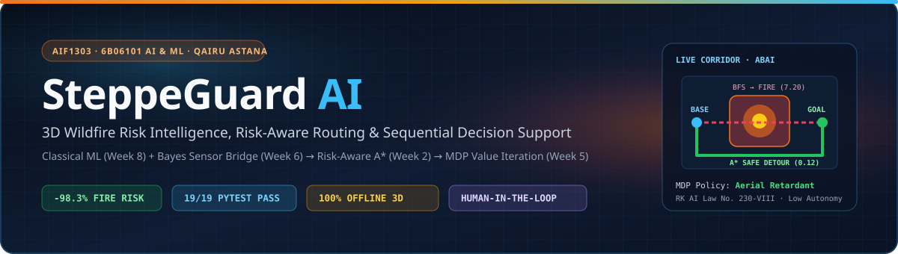
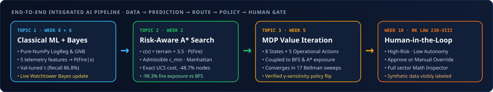
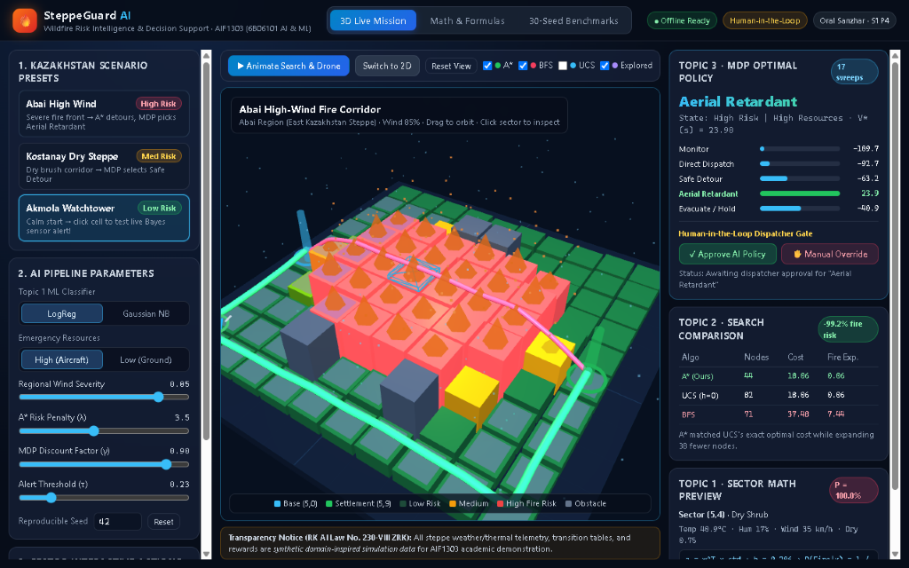
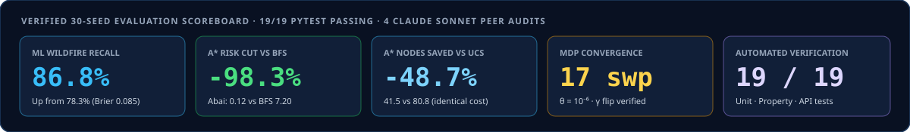
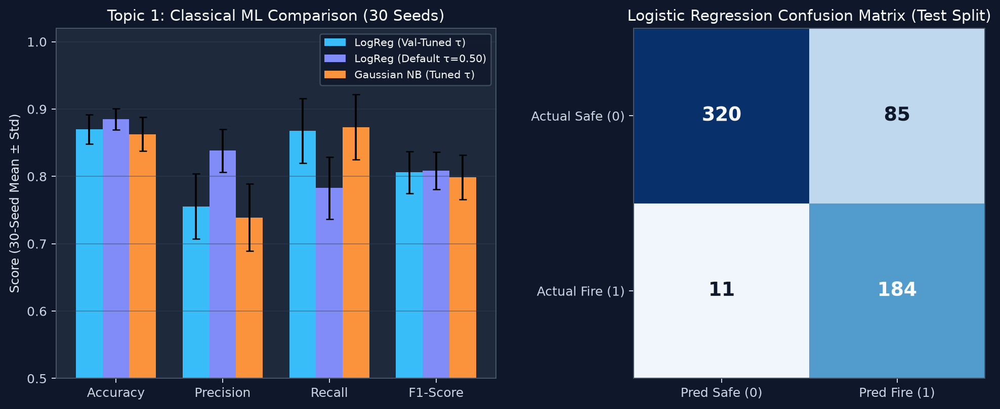
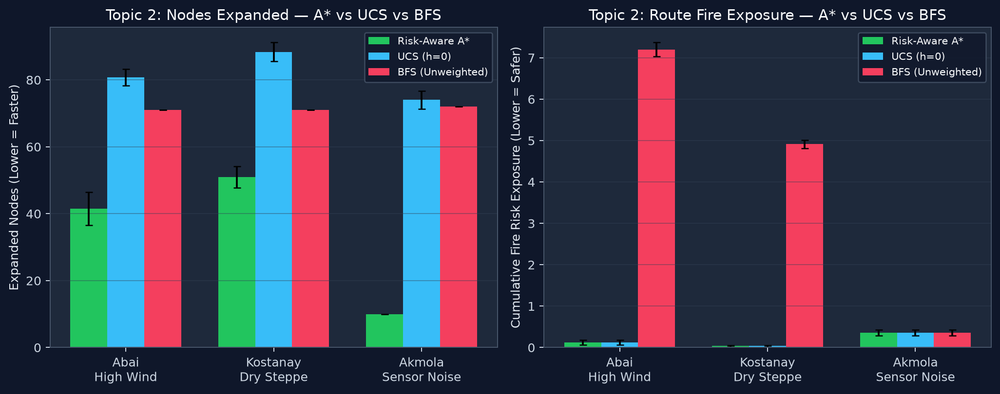
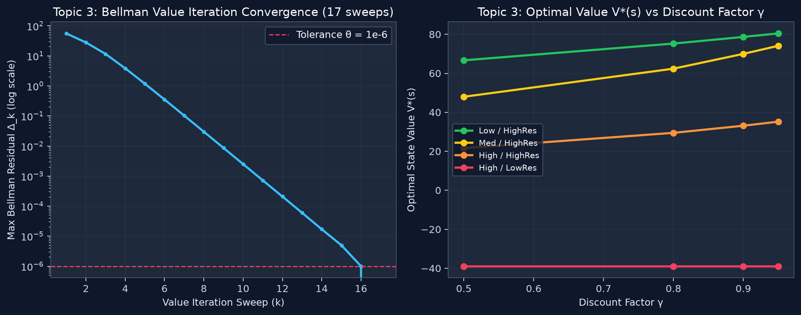

<div align="center">



<br>

<p align="center">
  <a href="https://steppeguard-ai.vercel.app"></a>
  <a href="#quantitative-benchmark-summary-30-seeds"></a>
  <a href="#three-integrated-ai-topics"></a>
  <a href="docs/SteppeGuard_Presentation.pptx"></a>
  <a href="docs/SteppeGuard_Demo_Video.mp4"></a><br>
  <a href="docs/AI_USAGE_DECLARATION.md"></a>
  <a href="#quick-start-runs-100-offline"></a>
  <a href="context/AUDIT_4_FINAL_RUBRIC.md"></a>
</p>

<p align="center">
  <a href="https://steppeguard-ai.vercel.app"><strong>LIVE 3D DEMO</strong></a> ·
  <a href="docs/SteppeGuard_Presentation.pptx"><strong>7-SLIDE DECK</strong></a> ·
  <a href="docs/SteppeGuard_Technical_Report.docx"><strong>TECHNICAL REPORT</strong></a> ·
  <a href="docs/SteppeGuard_Demo_Video.mp4"><strong>DEMO VIDEO (2:54)</strong></a>
</p>

**[Overview](#overview)** · **[Pipeline](#three-integrated-ai-topics)** · **[Live 3D Preview](#live-3d-command-center)** · **[Benchmarks](#quantitative-benchmark-summary-30-seeds)** · **[Quick Start](#quick-start-runs-100-offline)** · **[Deliverables](#deliverables-index)** · **[Responsible AI](#responsible-ai--kazakhstan-legal-framework)**

</div>

---

> [!IMPORTANT]
> **Course:** AIF1303 — AI Fundamentals (QAIRU, Astana, 2026–2027) · **Track:** 6B06101 *AI and ML* · **Author:** **Oral Sanzhar** (Stream 1, Practice 4 — Solo Project)
>
> **Live 3D App:** [https://steppeguard-ai.vercel.app](https://steppeguard-ai.vercel.app)  
> **Transparency Notice (Syllabus Section 8):** All weather/satellite telemetry maps, wildfire labels, transition probabilities, and MDP rewards are **synthetic, domain-inspired simulation data** designed for reproducible academic experimentation — not real MChS operational records.

---

## Overview

Kazakhstan's steppe regions (**Abai, Kostanay, Akmola**) face fast-moving wildfires driven by dry vegetation and strong winds. Simple shortest-path navigation drives crews straight into burning corridors, while reactive rules fail under noisy sensors and uncertain wind escalation.

**SteppeGuard AI** solves this by chaining **three distinct AI Fundamentals course topics** into one live, interactive 3D decision-support simulator following the course paradigm `DATA → PREDICTION → UTILITY → ACTION` *(Lecture 8, Slide 1)*:

1. **Where is fire risk highest?** → Pure-NumPy **Logistic Regression** & **Gaussian Naive Bayes** *(Week 8)* + live **Watchtower Bayesian Sensor Update** *(Week 6)*.
2. **What is the safest optimal route?** → **Risk-Aware A\* Search** consuming the ML risk grid directly, benchmarked against **UCS** and unweighted **BFS** *(Week 2)*.
3. **What long-term operational action maximizes safety?** → 8-State × 5-Action **Markov Decision Process (MDP)** solved via **Bellman Value Iteration** *(Week 5)*.

---

## Three Integrated AI Topics

 Risk-Aware A* -> MDP Value Iteration -> Human-in-the-Loop" width="100%">

<br>

| Topic | Course Module | Pure-NumPy Implementation | Coupling into Next Stage |
| :--- | :--- | :--- | :--- |
| **1. Classical ML + Bayes** | Week 8 & Week 6 | `StandardScaler`, `LogisticRegressionScratch`, `GaussianNBScratch`, val-tuned $\tau$, `bayes_sensor_update` | Outputs 10×10 fire risk grid $P(\text{Fire}\mid\mathbf{x})$ for A\* step costs & MDP state tier |
| **2. Heuristic Search** | Week 2 | `astar_search`, `ucs_search`, `bfs_search` with $c(v) = c_{\text{terrain}}(v) + 3.5\,P(\text{Fire}\mid\mathbf{x}_v)$ and admissible $h(n) = c_{\min}\cdot\text{Manhattan}$ | Passes per-step route exposures $E_{\text{direct}}$ (BFS) and $E_{\text{safe}}$ (A\*) into MDP transitions |
| **3. Sequential Decisions** | Week 5 | 8-state × 5-action tabular MDP solved via Bellman `value_iteration` + $\gamma$-sensitivity analysis | Outputs optimal policy $\pi^*(s)$ & $Q^*(s,a)$ to the Human-in-the-Loop dispatcher gate |

---

## Live 3D Command Center

<div align="center">
  
  <p><em>Interactive 100% offline Three.js 3D terrain (Abai High-Wind preset) with live flame cones, wind particles, animated 3D rescue drone, A* vs BFS overlay, 2D Canvas fallback, and click-to-inspect Math Inspector.</em></p>
</div>

### Instant Access via QR Code

<div align="center">
  <table>
    <tr>
      <td align="center" width="50%">
        <br>
        <strong>Live 3D Web App</strong><br>
        <a href="https://steppeguard-ai.vercel.app">steppeguard-ai.vercel.app</a>
      </td>
      <td align="center" width="50%">
        <br>
        <strong>GitHub Repository &amp; Docs</strong><br>
        <a href="https://github.com/sazmak/steppeguard-ai">github.com/sazmak/steppeguard-ai</a>
      </td>
    </tr>
  </table>
</div>

---

## Quantitative Benchmark Summary (30 Seeds)



<br>

| Module | Metric | Result (30-Seed Mean ± Std) | Key Takeaway |
| :--- | :--- | :---: | :--- |
| **Topic 1: LogReg (Val-Tuned $\tau$)** | Recall / F1 / Brier | `86.8% ± 4.8%` / `80.6% ± 3.1%` / `0.085` | Val-tuned $\tau \approx 0.353$ lifts Recall from `78.3%` (`τ=0.50`); Brier `0.085` vs `~0.22` baseline |
| **Topic 1: Gaussian NB** | Recall / F1 / Brier | `87.3% ± 4.8%` / `79.9% ± 3.3%` / `0.088` | Comparable F1 & Brier within 1 std; LogReg exposes direct interpretable weights |
| **Topic 2: Abai High Wind** | A\* vs UCS Nodes | `41.5 ± 5.0` vs `80.8 ± 2.5` | **-48.7% nodes expanded** at **identical optimal cost (`17.96`)** |
| **Topic 2: Abai High Wind** | A\* vs BFS Exposure | `0.12 ± 0.06` vs `7.20 ± 0.17` | **-98.3% cumulative wildfire exposure** vs unweighted BFS |
| **Topic 3: MDP Value Iteration** | Sweeps / Policy Flip | `17 sweeps` ($\theta = 10^{-6}$) | Three presets yield 3 distinct actions; `Med/HighRes` flips at $\gamma = 0.50 \to 0.80$ |

<details>
<summary><strong>Click to expand all 3 Matplotlib Benchmark Figures (ML · Search · MDP)</strong></summary>
<br>
<p align="center">
  <br><br>
  <br><br>
  
</p>
</details>

---

## Sample Input & Output (`preset_id="abai_high_wind"`, `seed=42`)

- **Input Sector `(5, 4)` Telemetry:** `Temp = 40.9°C`, `Humidity = 17%`, `Wind = 35 km/h`, `Dryness = 0.75`, `Thermal = 0.85`
- **Topic 1 (Logistic Regression):** `z = w^T x_std + b = +8.21` → `P(Fire | x) = σ(z) ≈ 99.97%` (`ALERT` at seed-42 `τ = 0.225`; 30-seed mean `τ = 0.353 ± 0.05`)
- **Topic 2 (Risk-Aware A\* vs UCS vs BFS — single seed-42 run):**
  - **A\*:** `44` nodes | Optimal Cost `18.06` | Fire Exposure **`0.06`** *(-99.2% risk vs BFS, -46.3% nodes vs UCS)*
  - **UCS:** `82` nodes | Optimal Cost `18.06` | Fire Exposure `0.06`
  - **BFS:** `71` nodes | Cost `37.48` | Fire Exposure **`7.44`**
- **Topic 3 (MDP Value Iteration — 17 sweeps):**
  - *Abai High Wind* → **`Aerial Retardant`** (`V* = 23.90`; switching Resources to `Low` flips to **`Evacuate / Hold`**)
  - *Kostanay Dry Steppe* → **`Safe Detour`** (`V* = 69.97`)
  - *Akmola Watchtower* → **`Direct Dispatch`** (`V* = 84.69`; Watchtower Smoke Alert at `(5,4)` updates belief `9.7% → 49.2%` via Bayes & reroutes A\*)

---

## Quick Start (Runs 100% Offline)

```bash
# 1. Create & activate virtual environment
python -m venv .venv
.\.venv\Scripts\Activate.ps1       # macOS/Linux: source .venv/bin/activate

# 2. Install runtime + test/benchmark dependencies
pip install -r requirements-dev.txt

# 3. Run all 19 automated unit, property, counterfactual & API tests
pytest -v

# 4. Launch the 100% offline 3D Web Application
python app.py
# Open http://127.0.0.1:8000 (zero external CDN required)
```

---

## Responsible AI & Kazakhstan Legal Framework

Aligned with **Law of the Republic of Kazakhstan *"On Artificial Intelligence"* No. 230-VIII ZRK (adopted 17 Nov 2025)** *(Course Deck `AI_Legal_Framework.pptx`, Slides 2–9, 21–22)*:

- **Risk Tier:** High-Risk emergency decision domain.
- **Autonomy Tier:** **Low Autonomy (Human-in-the-Loop)** — SteppeGuard AI recommends routes and policies with full mathematical explanations while a human dispatcher approves or overrides every action.
- **Transparency & Data Governance:** Synthetic telemetry is visibly labeled; zero personal or confidential data is processed; all AI tooling is transparently disclosed in [`docs/AI_USAGE_DECLARATION.md`](docs/AI_USAGE_DECLARATION.md).

---

## Deliverables Index

| # | Deliverable | File / Link |
| :---: | :--- | :--- |
| 1 | **Working 3D Application** | [https://steppeguard-ai.vercel.app](https://steppeguard-ai.vercel.app) · [`app.py`](app.py) |
| 2 | **GitHub Repository** | [https://github.com/sazmak/steppeguard-ai](https://github.com/sazmak/steppeguard-ai) *(tag `v1.0-submission`)* |
| 3 | **Technical Report** | [`docs/SteppeGuard_Technical_Report.docx`](docs/SteppeGuard_Technical_Report.docx) · [`docs/TECHNICAL_REPORT.md`](docs/TECHNICAL_REPORT.md) |
| 4 | **7-Slide Presentation** | [`docs/SteppeGuard_Presentation.pptx`](docs/SteppeGuard_Presentation.pptx) *(with live QR codes)* |
| 5 | **2–3 Minute Demo Video** | [`docs/SteppeGuard_Demo_Video.mp4`](docs/SteppeGuard_Demo_Video.mp4) *(`2:54`, 1280×720 HD)* |
| 6 | **AI Usage Declaration** | [`docs/AI_Usage_Declaration.docx`](docs/AI_Usage_Declaration.docx) · [`docs/AI_USAGE_DECLARATION.md`](docs/AI_USAGE_DECLARATION.md) |
| 7 | **Team Contribution Statement** | [`docs/Team_Contribution_Statement.docx`](docs/Team_Contribution_Statement.docx) · [`docs/TEAM_CONTRIBUTION_STATEMENT.md`](docs/TEAM_CONTRIBUTION_STATEMENT.md) |
| — | **Peer Audits & Process Logs** | [`context/WORKLOG.md`](context/WORKLOG.md) · [`context/PROMPT_LOG.md`](context/PROMPT_LOG.md) · [`context/AUDIT_4_FINAL_RUBRIC.md`](context/AUDIT_4_FINAL_RUBRIC.md) |

---

<div align="center">


**SteppeGuard AI**

Oral Sanzhar · Stream 1, Practice 4 · 6B06101 AI and ML · QAIRU, Astana

</div>
