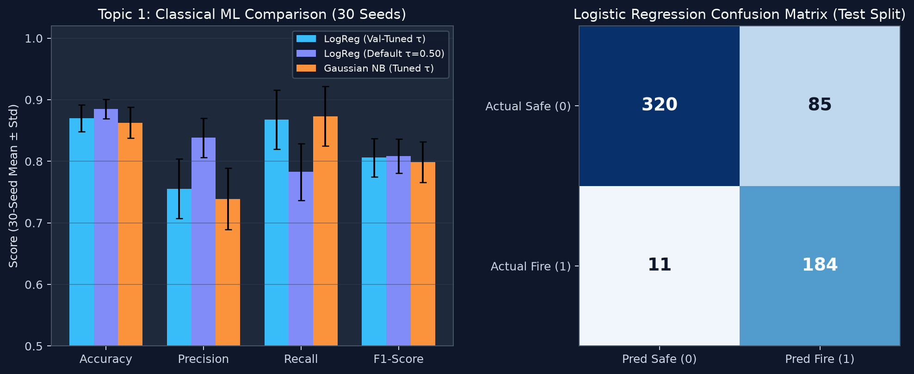
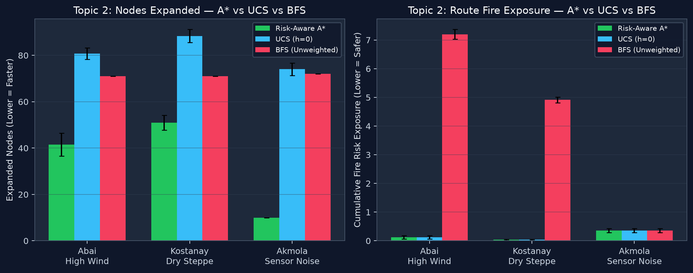
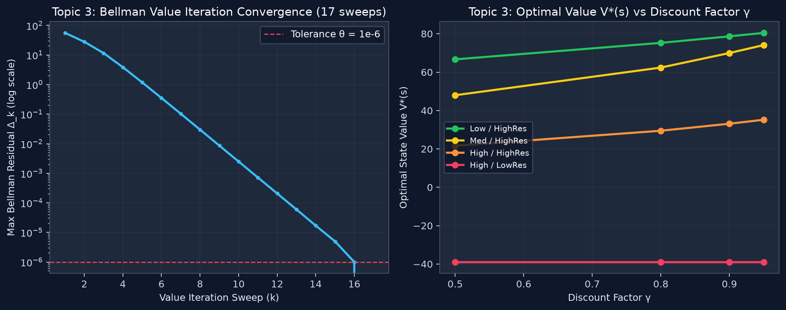

# SteppeGuard AI: Technical Report
**Wildfire Risk Intelligence, Risk-Aware Routing, and Sequential Decision Support for Kazakhstan's Steppe Regions**

- **Student:** Oral Sanzhar  
- **Group:** Stream 1, Practice 4  
- **Educational Program:** 6B06101 — AI and ML  
- **Course:** AIF1303 — AI Fundamentals (QAIRU, Astana, Trimester 1, 2026–2027)  
- **Project Type:** Solo Final Project  

---

## 1. Executive Summary & Real-World Problem
Vast dry grasslands and strong seasonal winds make steppe wildfires a recurring threat in Kazakhstan regions such as Abai, Kostanay, and Akmola. During a fire incident, emergency coordinators cannot rely on a single static map or simple if-then rules: weather telemetry is noisy, the shortest road may run directly through an active fire front, and every response decision changes the fire's future state and consumes limited aircraft/ground resources.

**SteppeGuard AI** is a transparent, offline-ready, 3D interactive decision-support platform that solves this problem by chaining **three distinct algorithms from the AI Fundamentals syllabus** into a single end-to-end pipeline following the course's core theme (*Lecture 8, Slide 1: `DATA → PREDICTION → UTILITY → ACTION`*):
1. **Classical Machine Learning (Week 8) + Bayesian Sensor Update (Week 6):** Predicts wildfire probability $P(\text{Fire} \mid \mathbf{x})$ for every sector on a 10×10 steppe grid using pure-NumPy **Logistic Regression** (compared against a **Gaussian Naive Bayes** baseline), with live exact Bayesian updating when a watchtower smoke sensor triggers.
2. **Informed Heuristic Search (Week 2):** Feeds the ML fire-risk map directly into **Risk-Aware A\* Search** to plan an optimal low-risk route from the Fire Base to the Target Settlement, benchmarked against **UCS** and unweighted **BFS**.
3. **Sequential Decision Making (Week 5):** Feeds the corridor fire risk, regional wind, and BFS/A\* route exposures into an 8-state, 5-action **Markov Decision Process (MDP)** solved by **Bellman Value Iteration** to recommend an optimal long-term operational policy $\pi^*(s)$.

> **Synthetic Data & Assumptions Disclosure (Syllabus Section 8 & `MiniAI_FPTopics.docx`):** All weather/satellite telemetry grids, wildfire labels, terrain costs, and MDP reward/transition tables are **synthetic, domain-inspired simulation assumptions** built for reproducible academic testing. They are not real Ministry of Emergency Situations operational records.

---

## 2. Agent Formalization: PEAS & Environment Taxonomy (Week 1)
Following the five-step agent design workflow from `Week 1.pptx` (Slides 4, 10–14, 38): `PEAS → Taxonomy → Representation → Architecture → Evaluation`:

| PEAS Element | SteppeGuard AI Operational Specification |
|---|---|
| **P — Performance Measure** | High wildfire recall (minimizing missed fires), low cumulative fire exposure along planned routes, high expected discounted long-term containment return $V^*(s)$, and transparent explainability for human dispatchers. |
| **E — Environment** | 10×10 Kazakhstan steppe grid containing terrain types (Steppe Plain, Dry Shrub, Rocky Ridge, Impassable Obstacles), regional wind, fire fronts, a Fire Station `(5,0)`, and a Target Settlement `(5,9)`. |
| **A — Actuators** | Risk heatmap alert flags, recommended response route, and high-level MDP policy recommendation (`Monitor`, `Direct Dispatch`, `Safe Detour`, `Aerial Retardant`, `Evacuate / Hold`) gated by a Human-in-the-Loop approval control. |
| **S — Sensors** | Five sector telemetry readings (Temperature °C, Humidity %, Wind km/h, Vegetation Dryness index, Satellite Thermal Anomaly) plus an independent noisy Watchtower Smoke Sensor (`TPR = 0.90`, `FPR = 0.10`). |

**Environment Taxonomy (`Week 1.pptx`, Slide 10):** Partially observable (noisy sensors), single-agent decision support (human-in-the-loop), stochastic (wind drives uncertain fire escalation), sequential (today's dispatch consumes resources and alters tomorrow's fire state), semi-dynamic across simulation steps, and discrete in both grid moves and operational actions.

---

## 3. Three Integrated AI Algorithms

### 3.1 Topic 1 — Classical Machine Learning (Week 8) & Bayesian Bridge (Week 6)
**Intuitive Analogy:** Like an experienced fire dispatcher weighing five weather clues into one danger score, then passing that score through a smooth S-curve (`sigmoid`) to turn it into a 0–100% fire probability.

- **Leakage-Free Dataset & 3-Way Split:** We generate 30 independent simulated steppe scenes (100 cells each = 3,000 samples) with correlated weather regimes, a physically motivated nonlinear interaction (`low humidity × high wind`), and 2% label noise. Splitting strictly **by scene** (`60% train / 20% validation / 20% test`) prevents spatial leakage (`Lecture 8, Slide 64`).
- **Standardization (`Lecture 8, Slide 46`):** $z_j = (x_j - \mu_j)/\max(\sigma_j, 10^{-8})$, fit strictly on `X_train`.
- **Logistic Regression (`Lecture 8, Slides 42–43`):** Implemented from scratch in NumPy using numerically stable sigmoid $\sigma(z) = 1/(1 + e^{-z})$ where $z = \mathbf{w}^\top \mathbf{x}_{\text{std}} + b$, trained via batch gradient descent minimizing binary cross-entropy with L2 regularization on weights $\mathbf{w}$ only (bias $b$ unpenalized).
- **Gaussian Naive Bayes Baseline (`Syllabus Week 8`):** Implemented in log-space with variance floor and log-sum-exp normalization so students can switch models live and compare predictions and feature contributions.
- **Cost-Aware Decision Threshold $\tau$ (`Lecture 8, Slides 22, 45, 60`):** Because missing a wildfire (False Negative) is far more dangerous than inspecting a false alarm (False Positive), we tune $\tau$ on the **validation split** by minimizing $2\cdot FN + 1\cdot FP$ (yielding $\tau \approx 0.35$ vs default $0.50$).
- **Live Watchtower Bayesian Update (`Lecture 6 PDF, Pages 55–60`):** When an operator receives an independent watchtower visual/smoke signal $E \in \{\text{Alert}, \text{Clear}\}$, the ML probability serves as the prior $P(\text{Fire})$ and updates via Bayes' theorem:
  $$P(\text{Fire} \mid E) = \frac{P(E \mid \text{Fire})\,P(\text{Fire})}{P(E \mid \text{Fire})\,P(\text{Fire}) + P(E \mid \neg\text{Fire})(1 - P(\text{Fire}))}$$
  Immediately after updating a sector's posterior risk, SteppeGuard re-runs A\* and the MDP so the route and policy adapt in real time.

### 3.2 Topic 2 — Informed Heuristic Search: Risk-Aware A\* (Week 2)
**Intuitive Analogy:** Like a GPS navigator that treats burning steppe sectors as severe traffic jams—accepting a slightly longer safe detour around the fire front while Manhattan distance focuses search straight toward the destination.

- **Direct Integration with Topic 1:** Every traversable cell $v = (r, c)$ receives a dynamic entry cost combining base terrain difficulty ($1.0$ plain, $1.35$ dry shrub, $1.85$ rocky ridge) and the ML-predicted fire probability:
  $$c(u \to v) = c_{\text{terrain}}(v) + \lambda \cdot P(\text{Fire} \mid \mathbf{x}_v), \qquad \lambda = 3.5$$
- **A\* Evaluation & Admissible Heuristic (`Lecture 2 PDF, Pages 29–38`):**
  $$f(n) = g(n) + h(n), \qquad h(n) = c_{\min} \cdot \big(|r_n - r_{\text{goal}}| + |c_n - c_{\text{goal}}|\big)$$
  where $c_{\min} = \min_{v \text{ free}} c(v) \ge 1.0$. Because every step on the grid costs at least $c_{\min}$ and Manhattan distance decreases by at most 1 per cardinal move, $0 \le h(n) \le h^*(n)$ holds everywhere (**admissible and consistent**). Therefore, A\* is mathematically guaranteed to match UCS's exact optimal cost while expanding far fewer nodes.
- **Baselines (`Lecture 2 PDF, Pages 14–28`):** Benchmarked with identical `(f, g, r, c)` tie-breaking against **UCS** ($h(n) = 0$) and unweighted **BFS** (FIFO queue ignoring fire risk).

### 3.3 Topic 3 — Sequential Decision Making: MDP & Value Iteration (Week 5)
**Intuitive Analogy:** *"Search returns a path; an MDP solution is a policy"* (`MDP_Reinforcement_Learning.pptx, Slide 4`). While A\* draws the best road on the map, the MDP gives the commander a complete decision playbook when strong wind can make the fire unpredictably escalate.

- **States $S$ (8 states):** 6 active states combining `{Low, Med, High} Fire Risk × {High, Low} Resources` plus 2 absorbing terminal states `Contained` ($V=0$) and `Escaped` ($V=0$).
- **Actions $A$ (5 actions):** `Monitor`, `Direct Dispatch`, `Safe Detour`, `Aerial Retardant` (resource-gated: consumes `High → Low` resources and is penalized when `Low`), and `Evacuate / Hold`.
- **Tight Coupling with Topics 1 & 2:**
  - The active state's risk tier is determined from the ML corridor fire probability binned against the validation-tuned threshold $\tau$.
  - `Direct Dispatch` transitions depend on the **per-step mean fire exposure of the BFS direct route** ($E_{\text{direct}}/\text{steps}_{\text{BFS}}$).
  - `Safe Detour` transitions depend on the **per-step mean fire exposure of the Risk-Aware A\* route** ($E_{\text{safe}}/\text{steps}_{\text{A*}}$).
  - Regional wind amplifies fire escalation probability.
- **Bellman Optimality & Value Iteration (`MDP_Reinforcement_Learning.pptx, Slides 26 & 29`):**
  $$Q_{k}(s, a) = \sum_{s'} P(s' \mid s, a)\,\big[R(s, a, s') + \gamma V_k(s')\big], \qquad V_{k+1}(s) = \max_{a \in A} Q_k(s, a)$$
  Repeated until $\max_s |V_{k+1}(s) - V_k(s)| < \theta = 10^{-6}$, yielding optimal policy $\pi^*(s) = \arg\max_a Q^*(s, a)$.

---

## 4. Testing, Verification & Quantitative Results
All algorithms are verified by **19 automated `pytest` tests** (`tests/test_ml.py`, `tests/test_search.py`, `tests/test_mdp.py`, `tests/test_integration.py`) covering extreme sigmoid overflow, zero-variance features, all-same-class edge cases, exact Lecture 6 Bayes calculation (`0.02 → 0.1552`), `start == goal`, blocked/unreachable corridors, 100-map A\* optimality property testing, 50-map heuristic admissibility testing, MDP stochastic row sums, counterfactual Search→MDP coupling flips, and FastAPI input validation.

To avoid cherry-picking a single map, `scripts/benchmark.py` evaluates **30 independent random seeds** (`mean ± std`):

### 4.1 Topic 1 Results — Classical ML (30 Seeds)
| Model | Threshold $\tau$ | Accuracy | Precision | Recall | F1-Score | Brier Score *(Base ~0.22)* |
|---|---:|---:|---:|---:|---:|---:|
| **Logistic Regression (Val-Tuned)** | `0.353 ± 0.05` | `87.0% ± 2.2%` | `75.5% ± 4.8%` | **`86.8% ± 4.8%`** | `80.6% ± 3.1%` | **`0.085 ± 0.010`** |
| Logistic Regression (Default) | `0.500` | `88.5% ± 1.6%` | `83.8% ± 3.2%` | `78.3% ± 4.6%` | `80.9% ± 2.8%` | `0.085 ± 0.010` |
| Gaussian Naive Bayes (Val-Tuned) | `0.353 ± 0.05` | `86.3% ± 2.5%` | `73.9% ± 5.0%` | `87.3% ± 4.8%` | `79.9% ± 3.3%` | `0.088 ± 0.009` |

*Analysis:* Lowering $\tau$ on validation intentionally trades slightly lower precision for a **+8.5 percentage-point jump in wildfire Recall** (`78.3% → 86.8%`), directly illustrating *Lecture 8 Slide 60 ("High accuracy ≠ good decisions")*. Logistic Regression and Gaussian Naive Bayes achieve **comparable** F1 (`80.6%` vs `79.9%`) and Brier scores (`0.085` vs `0.088`, within 1 std) — both far below the constant-prevalence Brier baseline $p(1-p) \approx 0.22$ (computed from the ~32.5% wildfire base rate on the test split). Logistic Regression additionally exposes direct, interpretable per-feature weights.

### 4.2 Topic 2 Results — Risk-Aware A\* vs UCS vs BFS (30 Seeds)
| Scenario | Algorithm | Expanded Nodes | Weighted Cost | Fire Risk Exposure |
|---|---|---:|---:|---:|
| **Abai High Wind** | **Risk-Aware A\*** | **`41.5 ± 5.0`** | **`17.96 ± 0.52`** | **`0.12 ± 0.06`** |
| | UCS ($h=0$) | `80.8 ± 2.5` | `17.96 ± 0.52` | `0.12 ± 0.06` |
| | BFS (Unweighted) | `71.0 ± 0.0` | `36.51 ± 0.69` | `7.20 ± 0.17` |
| **Kostanay Dry Steppe** | **Risk-Aware A\*** | **`50.9 ± 3.2`** | **`17.93 ± 0.62`** | **`0.04 ± 0.02`** |
| | UCS ($h=0$) | `88.4 ± 2.8` | `17.93 ± 0.62` | `0.04 ± 0.02` |
| | BFS (Unweighted) | `71.0 ± 0.0` | `27.70 ± 0.40` | `4.91 ± 0.10` |
| **Akmola Watchtower** *(ID: `akmola_sensor_noise`)* | **Risk-Aware A\*** | **`10.0 ± 0.0`** | **`10.24 ± 0.25`** | **`0.35 ± 0.07`** |
| | UCS ($h=0$) | `74.0 ± 2.7` | `10.24 ± 0.25` | `0.35 ± 0.07` |
| | BFS (Unweighted) | `72.0 ± 0.0` | `10.24 ± 0.25` | `0.35 ± 0.07` |

*Analysis:* Across all 90 preset runs and 100 random property-test grids, A\* matches UCS's exact optimal cost while cutting node expansions by **48.7% on Abai** and **86.4% on Akmola**, and cuts wildfire exposure by **98.3% on Abai** compared to unweighted BFS.

### 4.3 Topic 3 Results — MDP Value Iteration & $\gamma$-Sensitivity
- Value Iteration converges cleanly in **17 sweeps** to $\theta = 10^{-6}$.
- Across the three default presets, the integrated pipeline produces **three distinct optimal policies**:
  - *Akmola Watchtower* (`Low / HighRes`) → **`Direct Dispatch`**
  - *Kostanay Dry Steppe* (`Med / HighRes`) → **`Safe Detour`**
  - *Abai High Wind* (`High / HighRes`) → **`Aerial Retardant`** *(toggling to `Low Resources` flips to **`Evacuate / Hold`**)*
- **Discount Factor Sensitivity (`Lecture 5, Slides 16–17`):** At myopic $\gamma = 0.50$, `Med / HighRes` selects `Aerial Retardant` to capture immediate reward; at farsighted $\gamma \in \{0.80, 0.90, 0.95\}$, it switches to **`Safe Detour`**, conserving aircraft reserves and safely de-escalating `Med → Low`.

---

## 5. Interactive 3D Interface & Dual-Model Peer Audits
The frontend (`static/index.html`, `static/styles.css`, `static/app.js`) bundles `Three.js` locally (`static/vendor/three.min.js`) for **100% offline classroom reliability**, includes a **2D Canvas Fallback**, live search/drone animation, interactive sector math inspection, and a live Watchtower Bayes Alert trigger.

Throughout development, every stage underwent independent peer auditing using **Claude Code (Sonnet)** (`context/AUDIT_1_ARCHITECTURE.md`, `AUDIT_2_BACKEND.md`, `AUDIT_3_FRONTEND.md`) plus live headless browser visual QA—catching and resolving heuristic tuning, exposure normalization, GNB explainer parity, slider debouncing, and visual contrast issues prior to release.

---

## 6. Responsible AI, Kazakhstan Legal Compliance & Limitations (Week 10)
Aligned with **Law of the Republic of Kazakhstan "On Artificial Intelligence" No. 230-VIII ZRK (adopted 17 Nov 2025)** (`AI_Legal_Framework.pptx`, Slides 2–9, 21–22):
- **Risk Tier:** High-Risk emergency decision domain.
- **Autonomy Tier:** **Low Autonomy (Human-in-the-Loop)** — SteppeGuard AI recommends routes and policies with full mathematical transparency, while a human dispatcher explicitly approves or overrides every action.
- **Transparency & Data Governance:** Synthetic telemetry is visibly disclosed in the UI and report; zero personal or confidential data is collected.
- **Limitations & Future Work:** Real deployment would require historical Kazhydromet / MODIS satellite datasets, probability calibration (Platt/isotonic scaling), continuous wind-spread physics (e.g., cellular fire automata), and POMDP belief-state planning for partially observable smoke corridors.

---

## 7. References (Course-First Sourcing)
1. QAIRU Course Syllabus `AIF1303 — AI Fundamentals` (2026–2027 Academic Year).
2. QAIRU Lecture 1 (`Week 1.pptx`) & `AIF_Practical_1.2.docx` — *Agents, PEAS, Environment Taxonomy*.
3. QAIRU Lecture 2 (`b985f194-ff50-477d-a9fa-4d910e1cde4f.pdf`) & `AI_Fundamentals_Practice_week_2.docx` — *BFS, UCS, A\* and Admissible Heuristics*.
4. QAIRU Lecture 5 (`MDP_Reinforcement_Learning.pptx`) — *MDPs, Bellman Optimality Equation, Value Iteration, Discounting, Safety*.
5. QAIRU Lecture 6 (`499122fa-a771-4744-a3da-8be5b985e10e.pdf`) — *Probability, Bayes' Theorem, Sensor Diagnosis*.
6. QAIRU Lecture 8 (`Lecture 8_Rational_Decisions_Classical_ML.pptx`) — *Rational Decisions, Logistic Regression, Sigmoid, Thresholds, Precision/Recall/F1*.
7. QAIRU Legal Guide (`AI_Legal_Framework.pptx`) — *Law of the Republic of Kazakhstan "On Artificial Intelligence" No. 230-VIII ZRK, 17 Nov 2025*.
8. Russell, S. J., & Norvig, P. *Artificial Intelligence: A Modern Approach* (Pearson) — Syllabus Core Textbook.
9. Three.js r147 (`https://threejs.org/`, MIT License) — bundled locally in `static/vendor/three.min.js` for offline 3D visualization.
